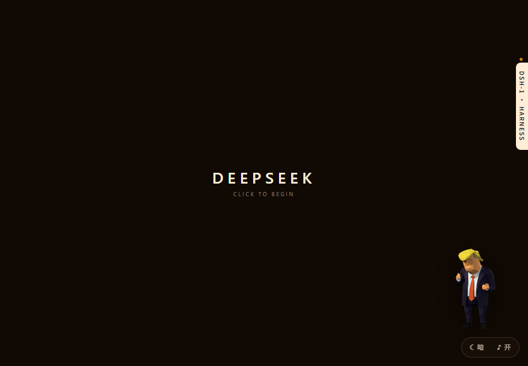
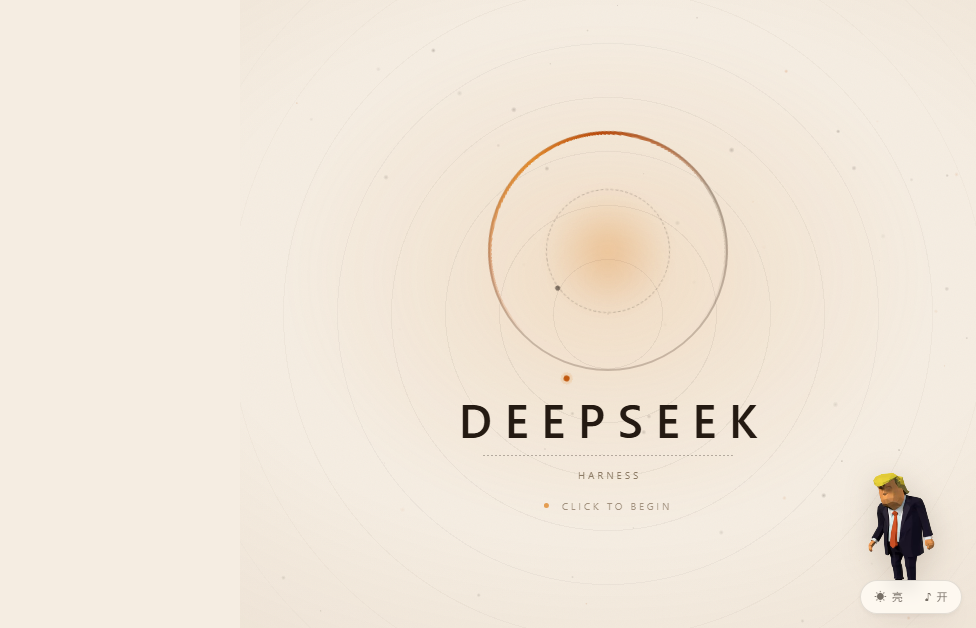
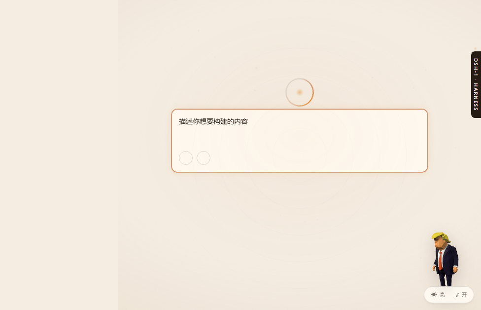
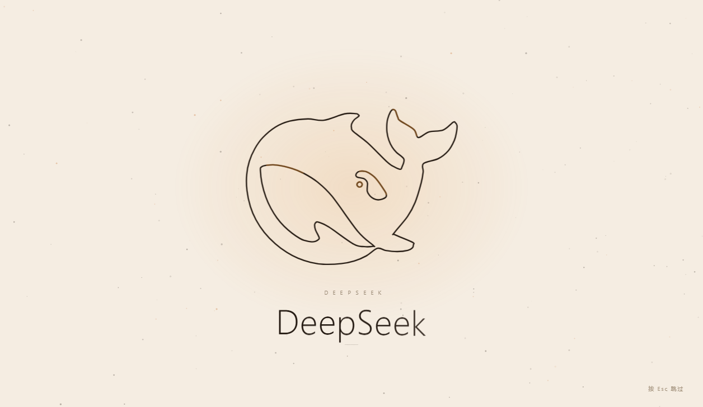
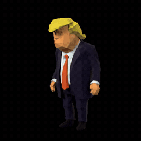
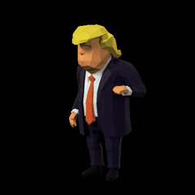

# ORYZO · DeepSeek Harness 主题插件

> 给 DSH 桌面端换一套 **暖墨 / 暖纸** 的双主题皮肤：环形粒子空态、鲸鱼片头、VS Code 风格音效、以及一只会在你思考时跳舞的 3D 桌宠。

一套插件，两层皮肤，两段片头，七个音效，一只桌宠。**明暗一键切换，动画与音效全部对齐。**



---

## 目录

- [这是什么](#这是什么)
- [效果预览](#效果预览)
- [功能特点](#功能特点)
- [安装](#安装)
- [使用](#使用)
- [快捷键](#快捷键)
- [项目结构](#项目结构)
- [自定义](#自定义)
- [已知限制](#已知限制)
- [素材与许可](#素材与许可)

---

## 这是什么

DSH 桌面端（DeepSeek Harness）的皮肤本质上是 **cordis bundle 插件**：一个 npm 包，通过 `cordis.patch.yml` 往应用里注入一行，再提供一个 `client.js` 在你的界面里注入 CSS + JS。

ORYZO 做的事：

| 层 | 内容 |
| --- | --- |
| **皮肤** | 暗色（暖墨）+ 亮色（暖纸），两套语义 token、圆角、阴影、滚动条、代码块、任务清单全部覆盖 |
| **空态舞台** | 环形粒子动画 + 鲸鱼线稿 + DEEPSEEK 字样，点一下淡出到输入框 |
| **片头动画** | 暗色沿用 deepseek-boot 的粒子版，亮色是线稿版，**两者共用同一条 7.28s 时间轴** |
| **音效** | 七个 VS Code 同族提示音（发送 / 思考 / 回答 / 需要操作 / 完成） |
| **桌宠** | 从 GLB 离线渲染的透明视频，右下角待机，**生成中自动循环跳舞** |
| **控制条** | 右下角 `☾ 暗 / ☀ 亮` 与 `♪ 开 / 关`，一键切换 |

---

## 效果预览

### 暗色空态


### 亮色空态



### 点击后进入输入框



### 片头动画（亮色 · 线稿版）



### 桌宠

| 待机（循环） | 生成中（自动跳舞） |
| --- | --- |
|  |  |

---

## 功能特点

### 1. 双主题，同一套几何

亮色皮肤**不是手写的**，而是由 `tools/make-light-skin.mjs` 从暗色皮肤自动生成：选择器换成 `html[data-dsh-theme="light"] body`，颜色换成暖纸色板，圆角、间距、层级全部保持一致。

所以两套主题的对话框、气泡、消息卡、工作区边框**几何完全一致**，只有颜色不同。

### 2. 语义 token 全覆盖

DSH 的组件引用 `--dsw-alias-*` 语义变量。皮肤把 **107 个别名**按主题重新指向：

```css
--dsw-alias-bg-layer-2: #1a1008;
--dsw-alias-settings-card-fill: #160e07;
--dsw-alias-label-primary: #ffedd7;
```

再加上一层**对比度兜底**：`tag.js` 会扫描聊天区里"底色和当前主题明显打架"的块（暗色里的浅底、亮色里的深底），标上 `data-dsh-fix`，由 `fix.css` 拉回正确表面色。任务清单、设置卡、代码块都属于这一类。

### 3. 空态舞台

- 暗色：环形粒子 + 中心光晕 + 鲸鱼曲线
- 亮色：线稿圆环 + 柔和光晕 + 鲸鱼线稿
- 点一下 → 文字淡出、遮罩淡出、输入框浮现，**首帧不闪白**

### 4. 片头动画共用时间轴

| 时间 | 事件 |
| --- | --- |
| 0.74s | 墨点爆散 |
| 1.40–3.30s | 鲸鱼描线 |
| 3.02s | 收笔（暗色是填充，亮色是线稿提亮） |
| 3.96–4.86s | 琥珀光扫过 |
| 3.98s | DEEPSEEK 逐字浮现（58ms 间隔、模糊 5px→0） |
| 6.32s | 收拢 |
| 7.28s | 移除 |

**一套音效同时服务两个主题**——因为时间轴是同一条。

### 5. 音效

| 场景 | 触发 |
| --- | --- |
| `send` | 发送消息 |
| `think` | 生成中（1.6s 循环） |
| `response` | 回答到达 |
| `ask` | 弹出需要你操作的对话框 |
| `done` | 任务完成 |
| `open` | 点击空态舞台 |
| `click` | 输入框按钮 |

### 6. 桌宠

- 素材：`lowpoly_trump_dance.glb` 里的 `IDLE`(6.71s) 与 `DANCE`(3.38s)，用 Blender EEVEE + `film_transparent` 离线渲染成 **VP9 + alpha 的 WebM**
- 播放：`<video>` 循环，**CPU 解码，不占用 WebGL / GPU 3D**
- 逻辑：平时 `idle`；检测到生成中的标记（`runningText` / `runningDivider` / `runningWhale`）→ 切 `dance` 循环；生成结束回 `idle`
- 体积：两段视频约 310 KB，base64 内联进 `client.js`

### 7. 控制条

右下角一个胶囊：`☾ 暗  ♪ 开`，点主题循环切换，点音效开关。

---

## 安装

### 前提

- DSH 桌面端（DeepSeek Harness）
- 能访问插件的 profile 目录：`%USERPROFILE%\.dsh\profiles\desktop\`

### 方式 A：从源码安装（推荐，可自己改）

```powershell
git clone https://github.com/yykyyk1/dsh-plugin-oryzo.git
cd dsh-plugin-oryzo
```

然后编辑 `%USERPROFILE%\.dsh\profiles\desktop\package.json`：

```json
{
  "dependencies": {
    "dsh-plugin-oryzo": "link:C:/path/to/dsh-plugin-oryzo/plugin"
  },
  "dsh": {
    "profile": {
      "bundles": [
        "@deepseek-ai/dsh-base",
        "@deepseek-ai/dsh-web-app",
        "dsh-plugin-oryzo"
      ]
    }
  }
}
```

- `bundles` 里**保留原本的条目**，只追加 `"dsh-plugin-oryzo"`；
- 路径用**正斜杠**，`link:` 后面的路径指向仓库里的 `plugin/` 目录。

### 方式 B：直接装打包好的 zip

1. 下载 Release 里的 `dsh-plugin-oryzo.zip` 并解压到任意目录；
2. 同样编辑 profile，把 `link:` 指向解压目录。

> ⚠️ 解压版**没有** `assets/`（素材已内联进 `client.js`）。想改源码重新构建，请用方式 A 的完整仓库。

### 重启

改完 profile 后**完全退出并重启 DSH**（不是只关窗口）。

---

## 使用

| 想做什么 | 怎么做 |
| --- | --- |
| 切换明暗 | 点右下角 `☾ 暗 / ☀ 亮` |
| 开关音效 | 点右下角 `♪ 开 / ♪ 关` |
| 进入输入框 | 空态画面点一下 |
| 跳过片头 | 任意键 / 点击 |
| 看桌宠跳舞 | 让它生成回答（思考中自动跳） |

主题和音效选择存在 `localStorage`，下次启动保持。

---

## 快捷键

| 快捷键 | 功能 |
| --- | --- |
| `Ctrl + Shift + L` | 切换明暗 |
| `Ctrl + Shift + M` | 切换音效 |
| `Esc` | 跳过片头 |

---

## 项目结构

```
plugin/
├── client.js                 # 构建产物：CSS + JS 全部内联（约 990 KB）
├── index.js                  # host 侧入口（空实现）
├── cordis.patch.yml          # 往应用里注入插件行
├── icon.svg
├── package.json
├── assets/
│   ├── pet/                  # 桌宠两段 WebM（构建时转 base64）
│   └── vs/                   # 七个音效 mp3（构建时转 base64）
├── src/
│   ├── skin-dark.css         # 暗色皮肤（源）
│   ├── skin-light-generated.css  # 亮色皮肤（由工具生成，勿手改）
│   ├── tokens-dark.css       # 暗色语义 token 覆盖
│   ├── fix.css               # 对比度兜底
│   ├── stage-dark.css/.js    # 暗色空态舞台
│   ├── stage-light.css/.js   # 亮色空态舞台
│   ├── splash.css/.js        # 亮色片头
│   ├── tag.js                # 结构标记 + 对比度扫描
│   ├── theme.js              # 主题/音效开关 API
│   ├── control.css/.js       # 右下角控制条
│   ├── sound.js              # WebAudio 合成引擎
│   ├── sound-hooks.js        # 音效触发点
│   └── pet.js                # 桌宠（视频版）
└── tools/
    ├── build.mjs             # 构建：内联素材 + 组装 client.js
    ├── make-light-skin.mjs   # 从暗色生成亮色皮肤
    └── boot-splash.mjs       # 重建 deepseek-boot 片头负载
```

### 重新构建

```powershell
cd plugin
node tools/build.mjs
```

需要 `assets/` 存在（音效与视频源）。构建产物是单文件 `client.js`。

---

## 自定义

| 想改 | 改哪里 |
| --- | --- |
| 颜色 | `src/skin-dark.css` 里的 CSS 变量，然后跑 `node tools/make-light-skin.mjs` 重新生成亮色 |
| 圆角 | `--dsh-oryzo-radius-*` 系列变量 |
| 桌宠大小 / 位置 | `src/pet.css` 的 `#dsh-oryzo-pet`（当前 150×150，right 2px，bottom 26px） |
| 桌宠动作 | 换 `assets/pet/*.webm`，用 Blender 渲新的透明视频 |
| 音效 | 换 `assets/vs/*.mp3` |
| 片头时长 | `src/splash.js` 里的 `T` 对象 |

---

## 已知限制

- **切工作区 + 新建对话**时，亮色舞台需要一次点击「新会话」才会重新显示圆环（app 会复用空态节点，插件靠监听「新会话」按钮来复位状态）；
- 桌宠是**预渲染视频**，不能看向鼠标、不能实时改姿势；
- `client.js` 约 990 KB（含 310 KB 视频 + 330 KB 音效 base64）；
- 只在 Windows 版 DSH 上验证过，macOS 未测；
- 亮色舞台的 `z-index` 被提到 `2147482000`（否则会 app 的空态层盖住）。

---

## 素材与许可

### 代码

本仓库的代码（`src/`、`tools/`、`client.js` 的组装逻辑、文档）**MIT 许可**，见 [LICENSE](LICENSE)。

### 第三方素材（不在 MIT 范围内）

| 素材 | 来源 | 说明 |
| --- | --- | --- |
| `assets/vs/*.mp3`（7 个音效） | Visual Studio Code 安装目录 `resources/app/out/vs/platform/accessibilitySignal/browser/media/` | 版权归 Microsoft。VS Code 源码是 MIT，但**媒体素材未在同一许可下授权再分发** |
| 桌宠模型 | `lowpoly_trump_dance.glb`（疑似 Super Smash Bros. 拆包 / Sketchfab 素材） | 版权与肖像权归原权利人 |
| 鲸鱼图标 | DeepSeek 官方品牌图形 | 商标归 DeepSeek |
| `deepseek-boot` 片头 | 原始 DSH 启动动画 | 仅作私用与学习交流 |

**这个仓库适合本机学习、改着玩。** 如果要公开发布到插件市场或商业使用，请把这些素材全部替换为自有或有明确授权的资源（合成音效、自有模型、自有图标）。

如果你只想留皮肤和动画、不带第三方素材：

1. 删掉 `plugin/assets/`；
2. 跑 `node tools/build.mjs` —— 音效会退回内置合成音，桌宠不显示；
3. 换掉 `icon.svg` 与 `src/` 里出现 `DEEPSEEK` 字样的地方。

---

## 致谢

- 动画节奏参考 DSH 自带的 `deepseek-boot`
- 音效取自 VS Code 的无障碍提示音（仅本机使用）
- 桌宠模型来自公开的 lowpoly 资源

---

## License

代码 MIT © 2026 yykyyk1
